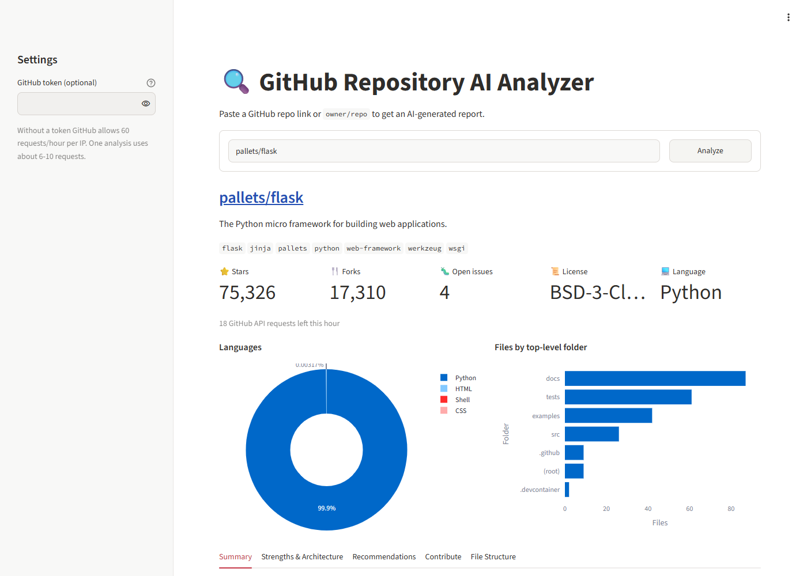
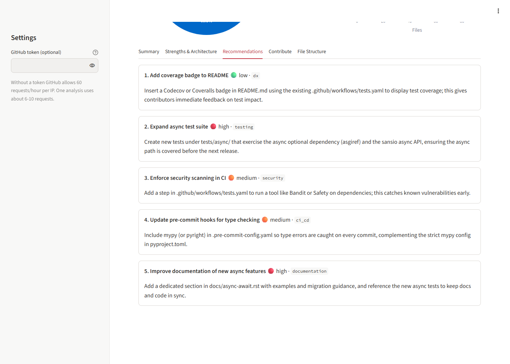

# GitHub Repository AI Analyzer

Paste any GitHub repo (`https://github.com/owner/repo` or just `owner/repo`) and get a quick AI report: what the project does, its tech stack, strengths, at least 3 practical improvement ideas, and where a new contributor could start.

**Live app:** https://app-repo-analyzer-it396haccgjo8ijzcvafpe.streamlit.app/





## What you get

- **Stats:** stars, forks, open issues, license and main language
- **Charts:** language breakdown and number of files per top-level folder
- **Tabs:** Summary · Strengths & Architecture · Recommendations · Contribute · File Structure
- **"Good first issue" list** pulled live from the repo
- **Clear error messages** for bad links, private or missing repos, rate limits, bad tokens and network problems

## How it works

```
your input → parse owner/repo → fetch data from GitHub → build prompt → Groq LLM → dashboard
```

1. **Parse:** a regex extracts `owner/repo`. Full URLs, `.git` endings and deep links like `/tree/main/src` all work.
2. **Fetch:** the app calls the GitHub REST API for:
   - repo info: `/repos/{owner}/{repo}`
   - README: `/readme`
   - file tree: `/git/trees/{branch}?recursive=1`
   - languages: `/languages`
   - package files (`requirements.txt`, `pyproject.toml`, `package.json`, …), only if they exist in the tree
   - good first issues: `/issues?labels=good first issue`
3. **Trim:** to stay within the model's limits, the prompt gets the first 6,000 characters of the README, the first 200 file paths and up to 4,000 characters of package files.
4. **Analyze:** Groq (`openai/gpt-oss-120b`) runs in **JSON mode**, and the reply is normalized into a fixed shape, so a slightly off response can't break the page.
5. **Cache:** GitHub data is kept for 10 minutes and AI reports for 1 hour, so refreshing doesn't waste API calls.

The code is split into three layers that don't depend on each other's details:

```
github_client.py  GitHub API calls, URL parsing, error types   (knows nothing about UI or AI)
analyzer.py       Prompt building, trimming, Groq call, JSON cleanup
app.py            Streamlit dashboard; turns errors into friendly messages
tests/            Unit tests with mocked HTTP (no network or keys needed)
```

## Rate limits

Without a token, GitHub allows **60 requests/hour** per IP, and one analysis uses about 6–10. You can paste a personal access token in the sidebar for **5,000/hour**. It's kept only in your session and never stored. The app shows how many requests are left, and if you run out it tells you when the limit resets.

## Why Groq + `gpt-oss-120b`

It's fast (a full report takes about 5 seconds), free to start with, and supports JSON mode, which the dashboard needs to fill each tab. The model follows the output format reliably and has a 131k context window. It runs with `reasoning_effort="low"` to stay quick. The model can be changed with `GROQ_MODEL`. I made it configurable after Groq retired the model I started with (`llama-3.3-70b-versatile`) during development.

## Run it locally

You need Python 3.10+ and a free [Groq API key](https://console.groq.com/keys).

```bash
git clone https://github.com/shruti01410/github-repo-analyzer.git
cd github-repo-analyzer

python -m venv .venv
.venv\Scripts\activate            # macOS/Linux: source .venv/bin/activate

pip install -r requirements.txt
copy .env.example .env            # macOS/Linux: cp .env.example .env
# open .env and paste your GROQ_API_KEY (GITHUB_TOKEN is optional)

streamlit run app.py
```

Run the tests with `pip install pytest` and then `pytest -q`.

**Deploying on Streamlit Cloud:** main file `app.py`. Under **Secrets**, add `GROQ_API_KEY = "gsk_..."` and optionally `GITHUB_TOKEN`. `.env` and `secrets.toml` are git-ignored.

## Limitations

- **It reads structure, not code.** The AI sees the README, file paths and package files, not the source itself.
- **Big repos are trimmed,** so later parts of a long README or file tree are skipped.
- **AI suggestions can be wrong.** Treat them as ideas to check, not facts.
- **Good first issues** only appear if the repo uses that exact label.
- **Shared limit:** without a token, everyone using the live app shares its 60 requests/hour.

## Open-source contribution

As part of this task I contributed a bug fix to **[databrickslabs/dqx](https://github.com/databrickslabs/dqx)**, Databricks Labs' data-quality framework.

- **Issue:** [#1747: MCP `get_table_schema` returns an empty schema when `DESCRIBE TABLE` returns no rows](https://github.com/databrickslabs/dqx/issues/1747)
- **Pull request:** [#1766: Raise a clear error when MCP get_table_schema finds no columns](https://github.com/databrickslabs/dqx/pull/1766)

**The problem:** some SQL warehouses answer `DESCRIBE TABLE` successfully but return no rows. The MCP tool then reported a table with zero columns, and an AI agent using it would carry on with the wrong schema.

**The fix:** the tool now raises a clear error naming the table when no columns are found. Normal tables behave exactly as before. I added two regression tests: an empty result, and a result containing only metadata rows. Both fail before the fix and pass after it, and the full MCP test suite (213 tests) passes. The commit is signed, as the project requires.

## Tech stack

Python · Streamlit · GitHub REST API (`requests`) · Groq API (JSON mode) · Plotly · pandas · pytest
